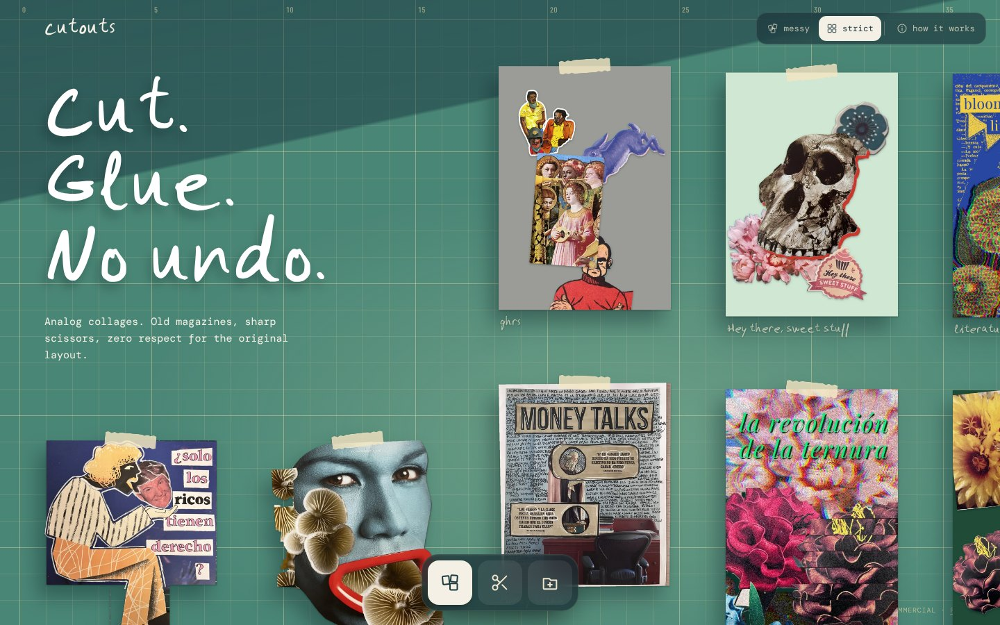
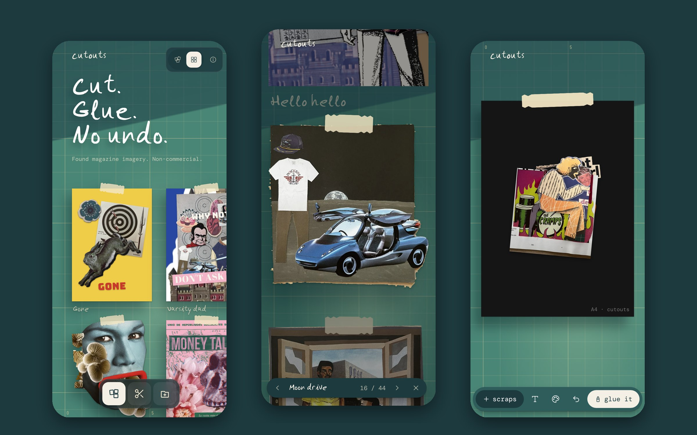
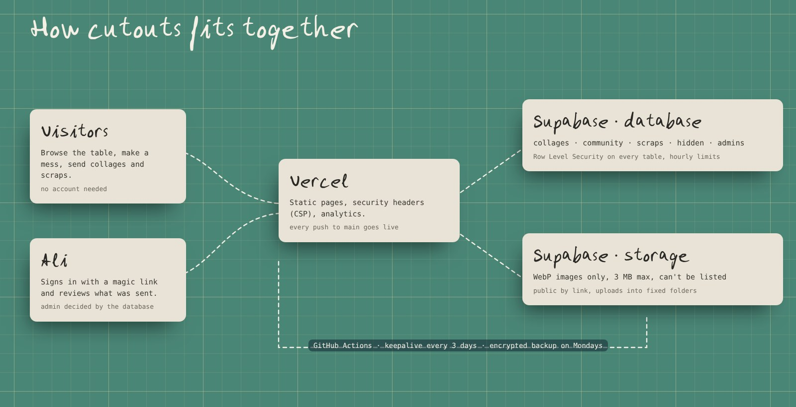

# cutouts

**Analog collages on a green cutting mat.** Wander a table of collages cut from old magazines, then make your own mess from the scrap pile and glue it down for everyone to see.

**[cut-outs.vercel.app](https://cut-outs.vercel.app)** · A personal design exploration by [Álida Díaz de Freijo](https://alidadiazdefreijo.framer.website/), built in pair with Claude.





## What it does

- **The table.** An endless mat you drag around, messy or strict. Click a collage to see it up close, with its story and an engraved print.
- **Make a mess.** Drag scraps onto an A4 sheet, add text, stack print effects (halftone, riso, duotone, warps, torn paper…) and cut images into pieces.
- **Glue it.** Name it, tell its story and send it to the table, optionally as a moving collage.
- **Add scraps.** Photograph a collage or a magazine page, give it shape, cut out bits for everyone's pile, even remove backgrounds.
- **Everything gets a look.** Visitors' collages and scraps wait in a private inbox until they're approved.
- **A first-visit tour** and a paper-pile entrance that paints the table.

## How it's built



| Piece | Job |
|---|---|
| **HTML, CSS and JavaScript** | The whole site, with no framework. Canvas does the cutting, the effects and the moving collages, all in the browser. |
| **Vercel** | Hosting, HTTPS, security headers and analytics. Every push to `main` goes live in about a minute. |
| **Supabase** | Postgres, image storage and the magic-link login. The database decides who can do what. |
| **GitHub Actions** | The night shift: keeps the database awake and takes a weekly encrypted backup. |

```
index.html          the table and make a mess
studio.html         add scraps (also shown inside the table page)
privacy.html 404.html
js/app.js           the table, the studio, effects, gluing
js/studio.js        photo, shape, cut, send, and the moderation inbox
js/vendor/          supabase-js and heic2any, self-hosted and pinned
css/ fonts/         small pages and the handwritten font
a/  s/              built-in collages and scraps (WebP)
icons/              favicons and web manifest
supabase/           schema, security and an audit query
.github/workflows/  keepalive, backup
vercel.json         security headers
docs/               database, operations and README images
```

## Why it holds

- **The doorman lives in the database.** Row Level Security is on every table and only `is_admin()` can approve, edit or delete. The public key in the code only opens what the rules allow.
- **Nothing goes on the table without a look.** Sends arrive as pending, with hourly limits, length checks and an inbox that closes when it's full.
- **Files can't be fished.** Images are WebP only, 3 MB max, uploaded into fixed folders and impossible to list.
- **The browser is on a short leash.** A Content-Security-Policy lets the page load only its own files, Supabase and Google Fonts. No inline scripts, no framing.
- **Photos lose their secrets.** Everything is redrawn in a canvas before upload, which strips location and camera data.
- **Someone works the night shift.** An encrypted backup runs every Monday and an alarm goes off if the site stops answering.

More in [docs/operations.md](docs/operations.md), including what to do if something goes wrong.

## Decisions worth explaining

- **No framework.** It's a canvas toy with a lot of motion and very little state. Plain JavaScript keeps it fast and every line readable.
- **No server of my own.** Supabase's rules do the job a backend would, so there's nothing to patch at 3 a.m.
- **The studio gets a looser policy than the table.** iPhone photos (HEIC) and background removal need `'unsafe-eval'` and WebAssembly. Those exceptions apply only to `studio.html` and the removal model loads only when you press the button.
- **Moderation over accounts.** Visitors never sign up. Anyone can send, and nothing is public until it's had a look.

## Run it locally

```
python3 -m http.server 8000
```

Open http://localhost:8000. To set up your own database, see [docs/database.md](docs/database.md).

## Credits and license

The **code** is released under the [MIT License](LICENSE).

The **collages and scraps** are made from found magazine imagery that belongs to its original owners, shown here as personal, non-commercial artwork. They are not covered by the license. Fonts are under their own licenses.
